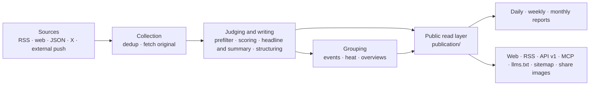

# Architecture



## Three processes

| Process | Location | What it does |
|---|---|---|
| api | `apps/api/` | Fastify. The site's own API (`/api/site/`), the public API (`/api/v1/`), RSS, MCP, the admin API, the image proxy, share images |
| worker | `apps/worker/` | pg-boss job queue and scheduled jobs: fetching sources, calling models, grouping, heat, daily reports, alerts, cleanup |
| web | `apps/web/` | Server-side rendered pages with React Router. Reads the api only over HTTP and never touches the database |

Business logic lives in `packages/backend/`; types and constants shared by frontend and backend live in `packages/contracts/`. This site's own name, copy, brand and pages are in `site/`; the industry's categories, sources, prompts and thresholds are in `industry/`; features that belong only to this site are in `modules/` (see [Modules](#modules) below).

## Rules that don't change

- **One public read layer**: web pages, RSS, the API, MCP, the sitemap and share images all read from `packages/backend/src/publication/`. The public scope, selection slots (machine outputs carry one entry per piece of news) and the conditions for factual evidence are defined only in `publication/scope.ts`; new outputs also follow the current retraction and full-text permissions. Published reports keep the text written for that edition, but whether a citation may be shown, the source name and the citation time still follow the current material; a retraction also removes the introductions and covers that depend on that citation.
- **Caching never extends the life of old content**: mutable content is revalidated when the response's `Cache-Control` expires. The sitemap's process, disk and HTTP caches share one expiry time, which must not restart when the response is sent; MCP HTTP responses use `no-store`. Your own proxies or CDNs must follow the same rules; see [Domain and HTTPS](deploy.md#domain-and-https) in the deployment guide for the requirements.
- **Pages don't call models**: a reader opening a page only reads results already in the database; models are only called in worker jobs.
- **Paid requests have receipts**: every paid request (models, X, Jina) records a receipt first, and results are stored before they are used. When a process restarts or a job retries, it reuses results that were already paid for instead of paying again (`providers/receipts.ts`). A receipt with an unknown outcome is released once automatically after 30 minutes; articles stuck in a failed state because of it are requeued to continue the unfinished body extraction or analysis. If the outcome is unknown again, an admin checks it on the "Runs" page and releases it.
- **Budget breakers**: each paid service has per-minute, per-hour and per-day limits and pauses once they are exceeded (admin "Settings → Paid request limits").
- **Safety valves**: `COLLECT_ENABLED`, `MODEL_CALLS_ENABLED`, `FEISHU_CONTENT_PUSH_ENABLED`, `FEISHU_INTERNAL_ENABLED` and `INDEXNOW_SUBMIT_ENABLED` only decide whether things are sent out, not which logic runs. They are only open when set to `true`; unset means off. The `.env` generated by `scripts/init-env.ts` turns on collection and model calls; set them to `false` when you are only working on the interface. In tests, pushes are always off, and collection and model calls only reach local fake services.
- **Public content is anonymous**: admins and visitors see the same thing; readers' saved and read items live in the browser. The admin area is for admins only.
- **Old articles don't flood the site**: material that was already more than 48 hours old when discovered, the backlog from a new source's first import, and backfilled pushes are archived by their original time; they don't enter "Today" and are not pushed. After the first import, older backlog items from a list are no longer collected. Material without a trustworthy publication time stays private until a date is found, and is then judged as new or old.
- **Sources are traceable**: every selected item links to the original; whether the site shows the full text is decided by the source's `site_fulltext`, and by default only the summary is shown.
- **Rules are maintained by the module that owns them**: the admin calls the content, event, notification and recovery modules and doesn't rewrite their state directly; business modules don't depend back on the admin. Manual changes are committed together with the public results and the records needed for recovery.
- **Cross-process interfaces share types**: the admin API follows `packages/contracts/src/admin.ts`, and job payloads follow `JobData` in `jobs/queue.ts`; sender and receiver are checked together. The frontend still reaches the backend only over HTTP.

These module boundaries are checked by `tests/architecture.test.ts`; when adjusting a boundary, update the convention and the check together. Site identity and the model for each step are read from `site/`, and industry categories and prompts from `industry/`; the code never hard-codes one site's values.

## Directories

| Location | Contents |
|---|---|
| `site/` | This site's own things: name and copy, the model for each step, brand and logo, terms pages, the four fixed files at the site root (`public/`, published after placeholders are replaced), the changelog, and which modules are enabled (`site/modules/`) |
| `industry/` | Industry pack: categories and tags, topics, demo sources, prompts, thresholds |
| `modules/` | Features that belong only to this site, one folder per feature (see [Modules](#modules) below); the framework itself ships no modules |
| `packages/backend/src/sources/` | Readers for the five kinds of sources, fetch scheduling (`collect.ts`) |
| `packages/backend/src/content/` | Storing material, dedup, body extraction and cleanup |
| `packages/backend/src/editorial/` | Judging and writing: `analyze.ts` (the pipeline), `prompts.ts` (reads prompts), `models.ts` (which model each step uses) |
| `packages/backend/src/events/` | Event grouping, heat, event overviews |
| `packages/backend/src/publication/` | The public read layer |
| `packages/backend/src/reports/` | Daily, weekly and monthly reports |
| `packages/backend/src/providers/` | Calls to models, embeddings, X and Jina; receipts and budgets |
| `packages/backend/src/notify/` | Feishu pushes |
| `packages/backend/src/operations/` | Alerts, backups, cleanup, IndexNow |
| `packages/backend/src/admin/` | The admin API |
| `apps/web/app/routes/` | One file per page; the route table is in `apps/web/app/routes.ts` |
| `database/migrations/` | Database migrations, run and recorded in order of their full file name |
| `scripts/` | Init, migration, seed data, evaluation and check scripts |
| `tests/` | Backend tests (the database name must end in `_test` or `_ci`; see below) |

## Modules

A feature the framework doesn't have and only your site needs (for example a dedicated leaderboard or monitoring page) becomes a module: one folder per feature, `modules/<name>/`, which is an npm package named `@aihot/<name>` holding its own backend, API, pages, styles, database migrations and tests.

| File | Contents |
|---|---|
| `module.ts` | Its addresses: pages, redirects, and paths handed to the api (types in `packages/contracts/src/modules.ts`) |
| `server.ts` | Its hooks into the backend: API routes, scheduled jobs, queues, event callbacks, data for admin pages and so on (`packages/backend/src/modules.ts`; each hook names the file that reads it) |
| `web.tsx` | Its hooks into the web app: pages, navigation items, widgets for topic pages and the admin and so on (`apps/web/app/modules.ts`); a widget that appears on only one page provides a loader function and is loaded with that page's code |
| `migrations/` | Its own tables, run together with `database/migrations/` in file name order |
| `tests/` | Its tests, run by `npm test` |
| Other files | Its own static files such as images also go in the module folder: register a route in the `http` hook of `server.ts` and serve them with `sendFile` from `apps/api/src/routes/static.ts` (it handles content types, ETags, cache headers and 404s; validate file names yourself), and list the addresses in `apiPaths` in `module.ts` |

Once written, list it in the three manifests in `site/modules/`: `index.ts` lists addresses, `server.ts` the backend, `web.ts` the web app; skip the ones it has nothing for. Then add it to `dependencies` in `site/package.json`. For Docker deployments, add a line `COPY modules/<name>/package.json modules/<name>/` to the `Dockerfile`, like the other packages. The framework code imports no modules and only reads these three manifests, so merging later updates from this repository rarely conflicts with your own features. When the hooks aren't enough, add a general-purpose hook to the framework instead of writing the feature into it.

Modules provide MCP tools through `agent.abilities`. `scripts/mcp-check.ts` always checks the complete tool set; a module can provide check arguments in `mcp.checkArgs` that succeed on an empty database. Without them, only tools whose input schema accepts `{}` are actually called with `{}`; the rest are only checked for discovery, with no guessed arguments. The business behavior of module tools is verified by the module's own tests.

## Database migrations

Released migrations are deployment history and must never be rewritten or deleted; fixes go in new files. Engine and module migrations follow the same conventions: they run in order of their full file name and are recorded by full file name; different files with the same number each run, and the same full file name must not appear in two directories. From `0055` on, each file holds a single statement that is safe to run online; PRs reject new migrations that break this, and a smaller number can't be used to get around the check. This avoids one statement locking a table and then, in the same transaction, waiting on another table or scanning a large amount of data.

New columns should be nullable or have a constant default. When adding a CHECK or foreign key to an existing table, add it as `NOT VALID` first and validate it in another migration. Indexes use a separate `CREATE INDEX CONCURRENTLY IF NOT EXISTS`. Release migrations must not run large UPDATEs or DELETEs, or hide them in DO blocks. Data backfills are separate, batched, observable operations, verified on a backup copy first.

When several filter conditions are correlated and the query planner badly underestimates row counts as a result, you can create MCV multi-column statistics for those columns, then `ANALYZE` those columns of the table in a separate migration. Verify the gain on the real distribution first; don't add statistics objects without evidence, and don't analyze the whole database in a migration or skip locked tables and assume success.

Destructive changes such as changing a type or dropping a column need their own upgrade and rollback steps, with the impact on existing data described in the [deployment guide](deploy.md#updating); the online migration check doesn't let them through directly. For a table the code no longer uses, once it is confirmed its data can be deleted, write `DROP TABLE IF EXISTS <table>` in a migration file of its own (without CASCADE, so the migration fails if objects still depend on it), and document it in the deployment guide as well. To widen the set of allowed statements, first show that the statement won't block requests being served for long, and add the matching checks; never turn off the check or edit the old ledger.

## Public outputs

An event's `related` link must be supported by at least two reports when it is created. Link history is kept. When a bridging report is explicitly retracted, loses its eligibility as a public factual report, is reclassified as a roundup, is moved out of the original fact, or a later grouping judgment denies the relation, the link stops being shown publicly once fewer than two valid pieces of evidence remain, and can be shown again once enough evidence returns. A report naturally leaving the recall window, or an ordinary revision that keeps its assignment, doesn't expire a link. For existing links without a checkable bridging judgment, a retraction is not inferred from missing records; an event that can't be read publicly is still not recommended. The meaning of `storyline` doesn't change with this rule, and all public outputs share the read rules.

| Address | Contents |
|---|---|
| `/` `/all` `/hot` `/topics` `/daily` `/weekly` `/monthly` | Selection, all items, trending events, topics, daily, weekly and monthly reports |
| `/feed.xml` `/feed/full.xml` `/feed/all.xml` `/feed/daily.xml` `/feed/weekly.xml` `/feed/monthly.xml` | RSS: selection, selection with full text, everything, daily, weekly, monthly; plus per-category `/feed/category/<key>.xml` and per-category full text `/feed/full/category/<key>.xml` |
| `/api/v1/` | Public API, documented at `/openapi-v1.json`; Markdown for agents starts at `/api/v1/agent`; the explainer page is `/agent` |
| `/api/mcp` | MCP server: one tool each for latest, search, trending, events, daily, weekly and monthly; tool names are prefixed with `mcpPrefix` from `site/site.ts` |
| `/llms.txt` `/sitemap.xml` `/robots.txt` | Information for language models and search engines (root files such as `robots.txt` are in `site/public/`) |
| `/admin` | Admin |

## Tests

```bash
npm run typecheck
DATABASE_URL=postgres://127.0.0.1:5432/myhot_test npm test
npm run build -w @aihot/web && npm run test:web
```

The database name in `DATABASE_URL` must end in `_test` or `_ci`; it is created and migrated automatically if missing. Each test file runs in parallel on its own copy, so the database account needs permission to create databases (`CREATEDB`). Tests never reach external services: models and paid APIs are answered by local fake services.
